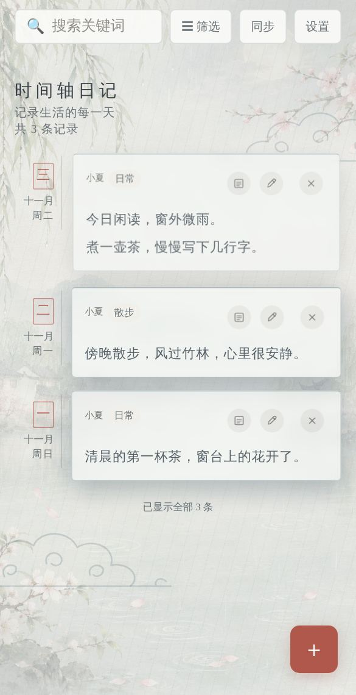
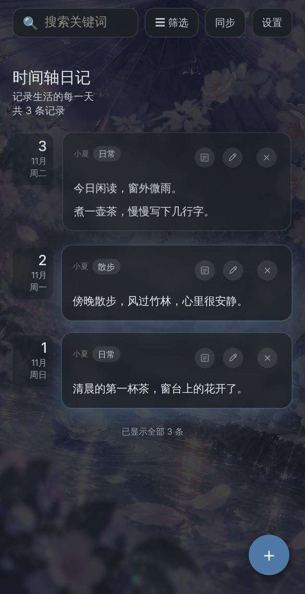

# 时间轴日记

一本**写在手机上的日记**：不用注册、不用装 App，离线也能写；日记只存在你自己的设备里。

### 👉 [点这里直接使用](https://sugatsu7-claude.github.io/timeline-diary/)

<table>
<tr>
<td align="center"><br>原样式</td>
<td align="center"><br>水墨国风</td>
<td align="center"><br>夜间</td>
</tr>
</table>

## 30 秒开始用

1. **用手机浏览器打开**上面的链接（iPhone 请用 Safari，安卓请用 Chrome）。
2. **添加到主屏幕**，以后像 App 一样点开：
   - iPhone：点 Safari 底部的「分享」→「添加到主屏幕」。
   - 安卓：点浏览器菜单 →「安装应用」或「添加到主屏幕」。
3. 点右下角的 **＋** 写第一篇。第一次会请你填一个名字。

就这样，**不需要账号，也不需要自己搭服务器**。仓库里的那些文件是给开发和自行部署的人看的，只想写日记的话可以完全不用管。

> 💡 你的日记**只保存在你这台设备的浏览器里**，不会上传，也不会和别人的日记混在一起。清除浏览器数据或换手机会丢失，所以请偶尔到「设置 → 数据与备份」做一次备份。

## 能做什么

- **写日记**：文字、照片、链接、地点、标签；可按日期、标签、关键词查找。
- **三种外观**：原样式、水墨国风、夜间；背景、卡片透明度可调。
- **文字卡片**：一键把日记做成好看的方形图片（三款风格），可保存或分享。
- **不怕误删**：删除后可一键撤销，还有 7 天回收站。
- **备份与恢复**：按时间范围导出备份文件，换手机时导入即可。
- **离线可用**：第一次打开后，没有网络也能写。
- **可选的 Notion 同步**：只有你主动点「同步」才会连接你自己的 Notion，不点就完全不联网。

## 常见问题

**要付费或注册吗？** 不用。

**日记会被作者或别人看到吗？** 不会。数据在你自己设备的浏览器里；只有你主动开启 Notion 同步，才会写到你自己的 Notion。

**删掉桌面图标会怎样？** ⚠️ 在 iPhone 上，「添加到主屏幕」的 App 和 Safari 是**分开存储**的，删掉桌面图标会**连同里面的日记一起删除**。删除或重新添加图标前，请先到「设置 → 数据与备份」生成备份，或确认已同步到 Notion。

**换手机怎么办？** 旧手机：设置 → 数据与备份 → 生成备份；新手机：同一页「从备份文件导入」。

**打不开或没有「添加到主屏幕」？** iPhone 需要用 Safari；用微信等 App 内置浏览器打开时没有这个选项，请先用系统浏览器打开。

**同步会经过作者吗？用谁的额度？** 不会经过作者。点「同步」时，你的手机直接连你自己部署的 Cloudflare Worker，再写进你自己的 Notion，用的是你自己的 Cloudflare 免费额度和 Notion。作者看不到你的日记，作者的 Worker 也不会被用到。作者只提供网页文件（GitHub Pages）。Worker 的 `ALLOWED_ORIGIN` 默认就是 `https://sugatsu7-claude.github.io`，用这个网页 + 自己的 Worker 不用改；把网页搬到别处托管时，再改成自己的网址。

**作者更新后，我会收到吗？** 直接用上面的链接：会，打开 App 时会提示有新版本，点一下即可更新。Fork 了仓库自己托管：不会自动更新，需要在自己的 Fork 页面点「Sync fork」。自己部署的 Worker 也不会自动更新；Worker 很少需要改，需要时会在这里注明。

**想同步到 Notion / 想自己部署一份？** 看下面折叠的说明。

> 🐾 我还做了小纸片人桌宠和英语单词挑战（手机网页版），欢迎来 [yanaic.com](https://yanaic.com) 逛逛～

---

<details>
<summary><b>可选：连接自己的 Notion 同步（需要一点动手）</b></summary>

[复制 Notion 空白模板](https://heather-butternut-b3d.notion.site/31a6c7418c3e4d26bdb3e515189d92c2) · [自行配置说明](SELF-HOSTING.md)

[](https://deploy.workers.cloudflare.com/?url=https%3A%2F%2Fgithub.com%2Fsugatsu7-claude%2Ftimeline-diary%2Ftree%2Fmain%2Fworker)

### 第一次使用

1. 打开 PWA，点击「设置同步」，或「设置」里的「首次连接向导」。不需要 Notion 时可关闭介绍，继续离线写日记。
2. 点击上方「复制 Notion 空白模板」，在 Notion 右上角选择复制到自己的工作区，字段和视图会一并带过去。后续使用自己复制后的数据库链接；也可按向导字段表手动建立数据库。
3. 创建自己的 Notion API token 连接，开启读取、插入、更新内容；用户信息选 No user information。将自己的数据库授权给这个连接。
4. 点击上方 Deploy to Cloudflare。登录自己的 Cloudflare/GitHub，按提示填写自己的 `NOTION_TOKEN`、`WORKER_SECRET` 和 `NOTION_DATABASE_ID`。最后一项可以直接粘贴复制后的 Notion 数据库链接。
5. 将部署得到的 Worker 根地址与连接码填入 PWA 向导，点击「检查连接」再保存。检查只读字段，不读取正文、不上传日记。
6. 返回首页，主动点击「同步」。首次连接会确认数据库，请先独立备份。

部署按钮进入的是本人账号中的配置/部署流程，首次登录、授权与填写凭据仍需本人完成。每个用户拥有独立的数据库和 Worker；前端不预填作者的服务器或密钥。

### 数据和凭据

- 日记、回收站、草稿、配置与同步状态在本机 IndexedDB；Notion Token 只放在自己的 Cloudflare Secret。
- 连接码默认在当前会话；勾选记住后保存在本设备，可主动忘记。不把真实 Token、连接码或日记提交到 GitHub。
- 公共 GitHub Pages 只托管应用文件。使用他人提供的 Worker 即向该服务发送日记，请使用自己的部署。
- 稳定无变化的增量同步通常只查询一次目录；首次、完整核对、变更较多时会分页或读写记录。数据库链接模式在 Worker 实例首次解析时多读一次数据库元数据，缓存1小时；无定时请求。
- 支持多窗口冲突副本、7天本机回收站、ZIP完整备份与恢复、图片安全清理、正文卡片。详见 [可靠性说明](RELIABILITY.md) 和 [卡片说明](CARDS.md)。
- Notion 无事务锁，请避免同步期间同时直接改同一篇。完整备份中复杂页面或缺失图片会明确标记不完整。

</details>

<details>
<summary><b>给开发者与自行部署的人：模板、开发、发布</b></summary>

默认背景为 `assets/IMG_0586.jpg`（水墨国风主题为 `assets/ink-bg.jpg`），包含离线缓存。

版本 `2026.11.05.1` 新增首次连接向导、独立 Worker 部署模板和数据库链接识别。现有用户继续使用原来的 Worker 地址与连接码，普通同步协议兼容；想使用新向导的「检查连接」需部署本仓库新版 Worker。

### 空白模板发布与维护

公开模板是独立空数据库，包含「全部日记／日历／回收站」视图，不是个人日记库的关联视图，也不包含个人记录或密钥。请复制到自己的工作区使用。维护者更换模板时，应先确认模板为空、独立，并开启公开访问和允许复制。

维护者将验证过的公开复制链接填入 [setup-config.js](setup-config.js) 的 `notionTemplateUrl`，同时在本页加入复制链接。空值时向导会明确说明暂未发布，并提供字段表，避免把用户引向私人页面。

复制本仓库自行托管时还应修改该文件的 `repository`（部署按钮的源仓库）以及 Worker 的 `ALLOWED_ORIGIN`。不在该配置中填写 Worker 地址或任何凭据。

### 开发和发布

需要 Node.js 22+、Python 3。测试只使用示例数据和模拟 Notion 服务。

```sh
npm ci
npx playwright install chromium
npm test
```

Worker 是完全独立的子项目，支持 Cloudflare 从子目录复制、安装并部署：

```sh
cd worker
npm ci
npm run check
npx wrangler deploy --dry-run
```

修改前端后统一更新版本、检查应用缓存并打包：

```sh
python scripts/release.py YYYY.MM.DD.RELEASE
python scripts/check-release.py
python scripts/package-release.py
```

`dist/frontend.zip` 仅包含网站必需文件；`dist/worker.mjs` 为 Worker 入口；`dist/source.zip` 为源码。手动上传 Pages 时解压前端包并上传全部内容，包括新增 JS 和 icons 文件夹。不要只传 index.html。

CI 校验版本、运行浏览器/Worker测试和 Worker dry-run，输出前端包；不会自动部署 Cloudflare、修改 Notion 或合并 PR。

### 可选地点

编辑日记时可填写地点名称、打开地图搜索，或主动点击「使用当前位置」记录手机坐标；地图分享链接可选填，仅填写名称时保留为文字地点，不生成模糊搜索链接。定位只在点击后请求权限，不会后台追踪。两项都不填时胶囊不显示地点行。支持按地点名称搜索，地点会随草稿、本机备份和手动 Notion 同步保留。

已有用户需先将 `worker/index.mjs` 更新部署到自己的 Cloudflare Worker，原有环境变量保持不变。新版 Worker 会在首次写入地点时自动补建「地点名称」（文本）和「地图链接」（URL）字段；也可在 Notion 修改这两列后手动同步回来。旧 Worker 遇到带地点的本机记录会提示升级，防止地点丢失。没有地点的普通记录继续兼容。

地点搜索在 PWA 内显示 Photon/OpenStreetMap 候选，选中后保存坐标；也可在小地图点击或拖动图钉，再确认位置。外部地图不再承担选点回传。地图仅在打开选点窗口后加载；搜索为点击触发，最多6项，短时结果在内存缓存。地图图块、Photon 搜索和带完整性校验的 Leaflet 1.9.4 来自第三方公开服务，不经过 Worker，不提供离线地图或服务可用性保证。地图不可用时仍可关闭窗口、使用手机定位或粘贴地图分享链接。

编辑页的照片以单行横向缩略图显示，右侧添加按钮固定；打开预览后可从本篇移除，保存日记后才提交修改。首页仍只显示照片图标。缩略图优先读本机，过期云端引用仅显示占位，点开预览才刷新。

界面保留原生滚动：工具栏随阅读方向轻微收紧与展开，细线显示阅读位置，保存后柔和归位。短胶囊随滚动连贯舒展，进入阅读区域后保持稳定，离开时收拢；长日记保持原尺寸。停下后安静，不叠加首次浮现动画。触屏按钮使用明确的按压状态。

滚动效果优先使用浏览器的滚动时间线；不支持时缓存卡片位置、集中处理布局读写，并短暂平滑收敛。普通滚动不逐张重新测量胶囊，停下后停止更新样式。遵循系统「减少动态效果」设置，不增加同步请求。

</details>
